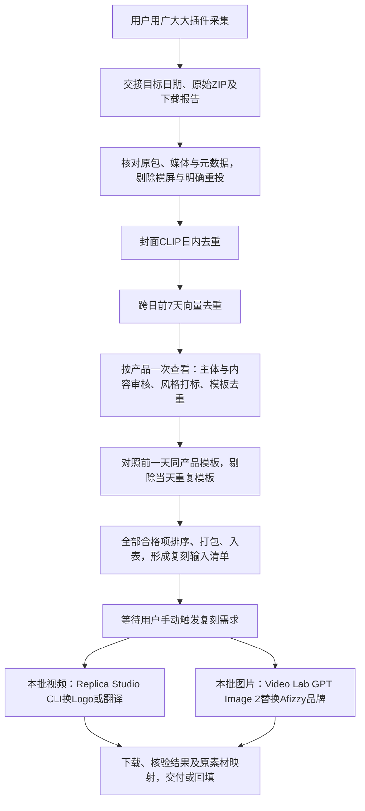

# Afizzy 竞品素材流程与路线图

更新日期：2026-11-03。本文记录用户确认的当前流程与后续方向；阶段能力以实际交付和验收证据为准。

## 项目目标

本项目旨在爬取竞品广告素材，筛选有参考价值、可用于复刻的素材，并通过复刻工具产出适用于自身产品的广告内容。**目前聚焦 Afizzy 项目**，主线为**爬取 → 筛选 → 复刻**。

原素材采集、筛选及入表核验后，等待用户手动触发复刻。主表每行一个需求和一个返回结果，不绑定需求池；视频使用Replica Studio CLI，图片使用Video Lab GPT Image 2。统一手动入口见[素材复刻CLI](material-replica-cli.md)，尚未启用主表图片自动监听。Playable复刻及视频换人生成为后续方向。

## 完整流程

Playable复刻及视频换人后续接入复刻阶段；无头定时采集验收后再替代当前手动交接入口。这些后续能力目前均未完成。

## 第一阶段：爬取

**当前情况**：用户在广大大页面设置目标日期及所需条件，用浏览器插件采集、下载，再交接原始ZIP（可多包）和目标日期。Agent从ZIP开始核对下载报告、原始媒体、日期和采集范围。导出时间不代替目标素材日期，接收到包不等于全部竞品已采齐。

当前插件源码在[`apps/guangdada-media-extension/`](../apps/guangdada-media-extension/)，版本为1.15.2。浏览器逐卡采集只作为明确要求时的备用方式，旧定时采集任务不因本文恢复。

**未来方向**：希望使用无头浏览器按插件逻辑定时、稳定地完成每日采集，减少手动开网页和交接的工作。

**当前进度**：已完成隔离环境的无头扩展样本核验，验证采集、翻页和日期截止；没有完成真实站点无人值守登录、授权、媒体下载与ZIP交付的生产闭环。样本通过不能代表可稳定每日运行。

**后续待完成**：

1. 明确运行机器、每日竞品范围、筛选条件和目标日期规则，配置独立持久化浏览器上下文及正常站点/媒体授权。
2. 完成实站登录、筛选恢复、媒体下载、断点恢复和原包交付；遇安全验证停止并请求人工。
3. 验收连续多日的完整率、失败原因、耗时和同日重跑去重后，再启用正式定时任务。当前不承诺上线日期。

## 第二阶段：筛选

**当前情况**：接收插件ZIP后，按以下顺序处理；详细操作以[`social-chat-browser-daily` skill](../skills/social-chat-browser-daily/SKILL.md)为准。

1. **横屏与重投剔除**：读取下载原素材真实显示宽高，宽>高剔除、方形及竖屏保留，计入视频旋转/SAR与图片EXIF；多图逐张核验，任一横屏整条剔除，尺寸缺失或读取失败暂缓。使用报告明确重投标签剔除重投，标签不明保持未知，不从文案猜测。保存尺寸与原文件SHA256，然后才进行封面去重。
2. **封面图日内去重**：同App/系统内，使用本机CLIP图像向量，阈值0.9，每簇保留展示估值最高者；无原封面时使用实际3%代理帧。
3. **跨日封面去重**：与目标日前7个自然日的同App/系统历史封面向量比对。缺历史日、身份或模型证据须留账，不能宣称完整覆盖；只用封面相似性不能证明整条视频完全重复。
4. **主体、风格与模板联合审核**：对去重剩余素材按产品俯瞰，视频一次准备并查看3%/15%/30%/50%/70%/90%六帧，同时完成内容审核、风格打标和产品内广告模板判断；图片逐张查看原图。已有源文件、参数和哈希一致的证据复用，存疑才补看。

联合审核同时完成主语言识别，交付入表时核验已有语言结果。入表前及进入复刻前分别重新读取本阶段原文件显示宽高与SHA256，横屏或尺寸未知均拦截；复刻结果回填前同样核验，不靠旧通过标记、缓存token或缩略图尺寸放行，不自动裁切横屏来补数。新scope固定`media_orientation_policy`，历史交付不自动重算。

当前内容规则为**男性角色有意义展示、女频恋爱或伴侣陪伴相关、无真人主持式产品推广口播**；女性配角或非推广口播的恋爱剧情不自动排除。内容或模板存疑暂不纳入。确认同模板且内容合格的每组只保留展示估值最高的一条，仅画风相同不合并。

**前一天模板去重（2026-11-03新增）**：在联合审核中，对照目标日前一天同App/系统完整已确认模板记录，并列查看双方六帧/原图及镜头、脚本、动作、交互、CTA依据。确认同模板则剔除当天项，存疑暂不纳入；当天估值更高也不替换历史。前一天无批次或证据不足记pending，不当零历史或称完整去重，不自行改成最近有数据日。新scope固定参考日期，恢复不漂移；当天已确认模板及跨日剔除关联也留作次日参考，不只保存入表项。这一步不同于前7天封面向量去重，不能仅凭CLIP分数完成；旧批不自动重算。

全部合格项按估值排序、打包并入表，**不再截前100条或前10%**。附件与ZIP内文件统一使用`日期-序号-广告主.原格式`，保留源文件、审核理由、风格和去重关联。原始广告附件与复刻结果分开保存。

**入表语言标签**：每条最终素材只写一个主语言，依据图片/视频中的主要文案和实际口播主体占比判断，视频同时核对完整音轨识别结果。原图/帧、OCR文字、ASR转写及时间和人工纠错依据绑定源SHA256保存。品牌名、商店徽标、零星外语和背景歌曲不决定主语言；不按投放国家、App或源包语言猜测。无法确定标待确认，无可判断文案且无口播时可标“无文案/口播”。写既有“文案语言”字段`fldcaMX7YL`；虽然字段为多选，每项仅写一个主语言。

**当前进度**：封面向量去重、联合审核、打包和飞书交付已有脚本及历史批次产物；主体与模板审核仍需实际查看证据，不是全自动判断。历史向量支持便携包，不能混用模型来源不明的旧向量。

**后续方向**：完善历史向量增量维护和包交接，固化按产品联合审核结果，并将最终筛选项、原媒体SHA256及记录ID组织为可直接交给复刻CLI的清单，减少重复抽帧与重复人工检查。仍保留存疑排除和人工复核。

## 第三阶段：复刻

复刻通过[主表独立入口](replica-main-table.md)触发：用户在原素材行选择“替换logo”或“替换语言”，后者先选齐多选目标语言，必定先换Logo再以其成品翻译。扫描到完整需求即上传，需求状态隐藏；最终成品核验后写同一行复刻附件。已有结果或断点不会重复执行，不绑定需求池；入表后不自动填写需求。

**素材类型进度**（用户于2026-11-02确认）：

| 素材类型 | 当前进度 | 后续方向 |
|---|---|---|
| 视频复刻 | 已完成 | 扩展换人能力，继续完善现有功能 |
| 图片复刻 | 已完成 | 维护现有图片复刻流程 |
| Playable复刻 | 未完成 | 实现Playable复刻流程并验收 |

上表记录复刻阶段按素材类型的完成情况，不表示每个素材批次都已处理完成。视频侧原`scripts/replica-studio`及其记录绑定批处理保留，见[Replica Studio CLI](replica-studio-cli.md)。新`scripts/material-replica`按类型分流；图片侧走Video Lab GPT Image 2，并沿[图片品牌复刻流程](../skills/social-chat-browser-daily/references/image-replication.md)做效果审核及既有字段回填。新适配器的参数校验和离线测试不等同于已完成付费图片效果实测。

### 图片：手动触发品牌复刻

2026-11-05用户纠正图片复刻范围为完整品牌替换：竞品应用图标、名称和字标都换为已认可Afizzy标识，正文及CTA中品牌词也需替换；非品牌文字、人物、场景、排版和原语言保持。此前“只换图标、保留Tipsy文字”理解错误，不能继续使用。无竞品品牌时不额外加标识，既有未知/失败任务不自动重做；用户指出的错误结果按明确授权定向纠正。

2026-11-03最新触发规则：采集、筛选和原素材入表核验照旧；入表后保存待复刻清单并停止，记awaiting_manual_trigger。视频和图片复刻都由用户明确指定批次、日期或需求记录后手动启动；历史scope里的自动复刻启用标记不能作为新启动授权。启动后按已确认范围自动排队、处理、核验及回填，不为每条重复询问。 默认配置已关闭image_replication_after_ingestion自动触发。

按2026-11-04用户最新要求，使用Video Lab CLI的`preset_image_editing`、`model-api-router / gpt-image-2`和已认可的[Afizzy品牌参考图](../skills/social-chat-browser-daily/assets/afizzy-approved-brand.png)。仅替换竞品产品名、图标、字标和正文/CTA中的品牌提及；保留人物、画风、构图、原文案语言及非品牌内容。无可识别竞品品牌时保持原图，不额外加标识。实际查看原图及成品，核对漏改品牌、拼写和非品牌内容；保持原比例与尺寸，不用本地绘图替代品牌生成。新统一CLI只执行生成及技术下载核验，不擅自将未做效果检查的结果写表。

通过项串行上传并写原记录现有“复刻附件”`fld6ygGkqD`，保留原竞品附件`fldRHIjFcO`和其他业务字段。以目标日、record_id、源SHA256、参考图SHA256和规则版本绑定状态；恢复复用已核验输出/附件，真实读回token、名称和精确大小。安全拦截记录并跳过，不原样重试或绕过；结果未知先核对，不盲目重新生成。入库与复刻各自统计，部分复刻失败不回滚原素材入库。

### 视频：CLI换Logo与翻译

当前功能为换Logo和翻译，后续实现换人。功能验证范围与上方素材类型进度分别记录。

| 能力 | 当前进度 | 后续工作 |
|---|---|---|
| 智能换Logo | CLI已封装；已有线上上传、处理、下载及附件回填证据。新串行分阶段调度已做离线回归，不能据此宣称所有新批次完成 | 继续核验新调度的实际批次表现、异常恢复和成品效果 |
| 翻译 | 已封装文字、语音、字幕及多语言提交、等待和下载；已做离线回归，已有28.4秒日语文字＋配音实测及解码核验，仍保留平台文字复查提示 | 验证目标语言成品、字幕/语音及原素材映射，再纳入具体批次需求 |
| 换人 | 当前CLI支持上传人物参考图，不提交人物图生成或视频换人生成 | 后续实现换人CLI、人物与素材绑定、任务恢复及效果审核，并完成真实样本验收 |

历史换Logo批处理保留分阶段兼容模式；当前主表使用逐条异步推进。单选替换logo只做Logo，单选替换语言则必须先做Logo、核验成品为实际翻译输入，再按目标语言翻译并回填多附件。底层独立translate命令仍可按明确需求调用，不据底层命令的可选性绕过主表Logo前置。

复刻输入应来自最终筛选清单，保持源文件SHA256、广告/飞书记录与真实任务ID的对应关系。收到上传或生成回执不等于成品已交付；实际下载、大小与哈希核验、视频完整解码或图片解码及结果读回后才记录对应完成。服务端复查提示保留，不能以下载成功代替效果审核。Playable复刻尚未完成，不作为现有复刻能力交付。

**未来方向**：素材类型上补齐Playable复刻；视频功能上在现有Logo和翻译能力基础上增加换人，并完善从筛选清单到复刻成品的交付追溯。新增能力分别实现及验收。

## 阶段交接与完成口径

| 阶段 | 必须交接的产物 | 完成口径 |
|---|---|---|
| 爬取 | 目标日期、原始ZIP、下载报告与实际媒体 | 包与媒体可核验，成功/失败和实际范围清楚；不能仅凭ZIP存在判断全采完成 |
| 筛选 | 去重账、审核/模板/风格记录、最终合格清单、素材包及实际入表记录 | 合格项均有证据，排除与存疑有理由；入表需真实附件及读回 |
| 复刻 | 原素材与任务映射、处理回执、核验后的结果及交付/回填记录 | 实际成品符合所选动作并可追溯；失败、结果未知或待复查分别保留 |

当前计划不附虚构进度百分比或上线期限。后续更新应记录实际完成内容、验证范围和剩余问题；旧VE/Arrow2说明及历史批次规则不自动覆盖Afizzy当前流程。

## 相关小红书流程

此次同步的社媒素材规则与广大大App采集分开，详见[小红书接入](social-chat-xhs-daily.md)：

- t日执行筛北京时间t−1自然日，目标日固定后恢复不漂移；搜索接口窗口不等于全站自然日完整覆盖。
- 日期筛选后先保留不少于100赞的笔记，再获取媒体和实际审核；全部合格项入表，不截前100篇。新批固定的`like_filter`优先于为旧批保留的`ranking.top_n`配置。
- 视频按真实首视频流时长保留至300秒（含），超过上限在完整解码与抽帧前排除。
- 7关键词均尝试，至少4词真实到末页时可部分交付，必须披露未完成词；详情最多3次、媒体获取/校验最多3轮，恢复不清零，耗尽单列未审核。未知搜索提交不自动重发。
- 小红书图片/视频共用其目标表附件字段`fld8kRrOQY`，与广大大同名列ID不同；保留原附件、手动记录及历史回执，实际读回核验后才计入表成功。

这些是处理规则，不是对当前机器调度状态的确认；本次文档同步不启停任何任务。
